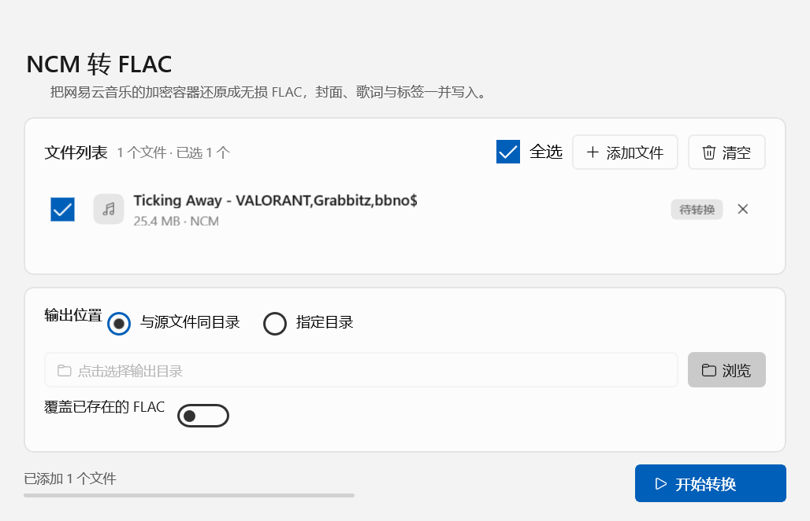

# NCM 转换


[](#环境要求)
[](#构建)
[](#实现说明界面为什么是手搓控件)
[](#分发便携版)

用 C++ / WinUI 3 写的小工具，把网易云音乐的 `.ncm` 加密容器还原成里面的原始码流 —— **不重新编码**：
容器里是 FLAC 就输出逐字节无损的 FLAC，是 MP3 就原样输出 MP3（补上 ID3 标签），
封面、标签和歌词一并写入。



## 快速开始

不想自己编译的话，直接下 [Releases](../../releases/latest) 里的 `NcmConverter-win-x64.zip`：

1. 解压到任意目录（绿色免安装，不用装 .NET、VC++ 运行库或 Windows App SDK）
2. 双击 `NcmConverter.exe`
3. 把 `.ncm` 拖进窗口，点「开始转换」

如果双击时弹出「Windows 已保护你的电脑」，那是 SmartScreen 对带"来自 Internet"标记的
文件给的提示 —— 右键属性勾一下「解除锁定」，或双击包里的 `解除锁定.cmd` 就没
了，原因写在[这里](#双击后弹出windows-已保护你的电脑)。

想自己编译见[构建](#构建)。

## 目录

[功能](#功能) · [环境要求](#环境要求) · [构建](#构建) · [分发（便携版）](#分发便携版) ·
[使用](#使用) · [NCM 容器的解包流程](#ncm-容器的解包流程) · [校验](#校验) ·
[代码结构](#代码结构) · [实现说明](#实现说明界面为什么是手搓控件) · [调试钩子](#开发与调试钩子)

## 功能

- **两种输出**：FLAC 码流 → `.flac`（VORBIS_COMMENT + PICTURE）；MP3 码流 → `.mp3`（ID3v2.3 + APIC），
  扩展名由码流本身决定，不需要手动选
- **批量转换**：把 .ncm 拖进窗口任意位置，或用「添加文件」多选；支持全选 / 逐个移除
- **拖放提示**：文件拖到窗口上方时整窗铺一层浅蓝，中间浮出一张小卡片写着「松开即可添加」
  与本次拖进来的 .ncm 数量，鼠标指针同时变成"复制"样式
- **输出目录**：默认写回**每个文件自己的源目录**（文件来自不同文件夹时各归各位），
  也可统一指定一个目录
- **直接覆盖**：目标文件已存在时直接重写，不再多问一句
- **跟随系统主题**：浅色 / 深色跟随 Windows，强调色固定为 Windows 11 的默认蓝（浅色 #005FB8 / 深色 #60CDFF）；系统切换主题时
  窗口会实时重绘（包括标题栏）
- **一键打开目录**：转换完成后直接跳到输出位置（输出分散在多个目录时跳到它们的公共上层）
- **完整标签**：TITLE / ARTIST / ALBUM / ALBUMARTIST / TITLE_TRANSLATED / MUSIC_ID /
  COMMENT / LYRICS / ENCODER
- **封面嵌入**：把 NCM 内嵌的专辑图作为 FLAC 的 PICTURE 块（front cover）或 MP3 的 APIC 帧
- **歌词**：优先用 NCM 内的歌词（逐行 JSON、YRC 卡拉OK 两种格式都会转成标准 `[mm:ss.xx]` LRC），
  没有时回退到同名 `.lrc` 文件
- **命令行模式**：`NcmConverter.exe --convert in.ncm [out]`，结果写 `<输出>.log`，便于批处理与回归测试

## 环境要求

| 项目 | 要求 |
| --- | --- |
| 系统 | Windows 10 1809 (10.0.17763) 及以上 |
| 编译器 | Visual Studio 的 C++ 生成工具（x64）；本仓库在 VS 2026 BuildTools / MSVC 14.51 / 工具集 v145 上验证 |
| SDK | Windows SDK 10.0.26100.0 |
| 依赖 | Windows App SDK 1.8（C++/WinRT）与 WebView2 的 WinRT 元数据包；不打包、自包含部署 |

## 构建

```powershell
# 1. 下载 Windows App SDK / C++/WinRT 等 NuGet 包（解压到 %USERPROFILE%\.nuget\packages）
powershell -ExecutionPolicy Bypass -File tools\fetch-packages.ps1

# 2. 编译
powershell -ExecutionPolicy Bypass -File build.ps1 -Configuration Release
```

产物：`bin\x64\Release\NcmConverter.exe`，同目录带上 Windows App SDK 运行库 DLL；
`build.ps1` 还会把 VC++ 运行库（`msvcp140.dll` / `vcruntime140.dll` / `vcruntime140_1.dll` 等）
从 `Microsoft.VC145.CRT` 拷进来，所以整个文件夹可以原样拷到别的电脑上运行。

> 没有走 `msbuild -t:Restore`：Build Tools 里不带 NuGet.targets，所以由
> `tools\fetch-packages.ps1` 按 nuspec 递归抓包、解压到标准 NuGet 目录，
> vcxproj 里再用显式 `Import` 引用。换机器时改 vcxproj 顶部的 `PlatformToolset`、
> `WindowsTargetPlatformVersion` 与 `PackageVersions` 组即可。

## 分发（便携版）

```powershell
powershell -ExecutionPolicy Bypass -File tools\package.ps1 -Configuration Release
```

产物 `dist\NcmConverter-win-x64.zip`（约 20 MB），`dist\NcmConverter-win-x64\` 是未压缩的同一份文件夹。

包里的东西让它在别的电脑上"解压即用"，什么都不用装：

- **VC++ 运行库**：`msvcp140.dll` / `vcruntime140.dll` / `vcruntime140_1.dll` 等与 exe 同目录
  （app-local 部署），目标机不需要装 Visual C++ 运行库；
- **Windows App SDK**：自包含部署，框架 DLL 与 `.pri` 都在包里，同样不需要安装；
- **使用说明.txt** 与 **解除锁定.cmd**，处理下面这个问题。

系统要求只有一条：Windows 10 1809（17763）及以上的 64 位 Windows。

### 双击后弹出「Windows 已保护你的电脑」

这是 SmartScreen 对**带「来自 Internet」标记（MOTW）**的可执行文件给出的提示。标记是下载或
用资源管理器解压 zip 时由 Windows 自己写进文件的（NTFS 的 `Zone.Identifier` 数据流），
与程序本身有没有问题无关——本机直接双击同一个 exe 就不会弹窗，因为它没有这个标记：

```text
PS> Get-Item bin\x64\Release\NcmConverter.exe -Stream *
:$DATA        ...
```

去掉标记即可，不需要证书、也不需要改注册表：

- 右键 `NcmConverter.exe` → 属性 → 勾选「解除锁定」→ 确定；
- 或者双击包里的 `解除锁定.cmd`，它对整个目录执行 `Unblock-File`；
- 或者别用资源管理器解压：用 7-Zip / WinRAR 解压，或从 U 盘、局域网共享整目录拷过去，
  文件不会带上这个标记，双击直接开。

想让提示对任何机器都彻底消失，只能买代码签名证书（EV 证书才有一开始就有的信誉），这里不做。

## 使用

1. 运行 `NcmConverter.exe`
2. 把 `.ncm` 文件拖进窗口，或点「添加文件」多选
3. 选输出位置（默认写回各文件自己的源目录，可改为统一目录）
4. 点「开始转换」，状态胶囊从「待转换」变成「完成」

窗口默认尺寸 640 × 360，会按系统 DPI 缩放。

## NCM 容器的解包流程

`.ncm` 是网易云音乐加过密的容器，内部本来就存着完整的 FLAC / MP3 码流，解密即可，不需要转码：

1. 文件头 `CTENFDAM` + 2 字节，随后是 `uint32` 的密钥长度
2. **音频密钥**：密文逐字节 XOR `0x64` → AES-128-ECB 解密 → **去掉 PKCS#7 填充** →
   去掉 `neteasecloudmusic` 前缀，剩下 98 字节作为音频解密种子。
   最常见的坑就是忘了去填充：种子多出十几个字节，解出来的音频全是噪声
3. **元数据**：`uint32` 长度 → 逐字节 XOR `0x63` → 去前缀 `163 key(Don't modify):` →
   Base64 → AES-128-ECB 解密（另一把固定密钥）→ 去填充 → 去 `music:` 前缀 → JSON
4. 跳过 CRC32 / 版本号 / 封面长度字段，读封面图（JPEG / PNG / WebP / GIF），音频从封面之后开始
5. **音频**：用种子做 KSA 生成 256 字节置换盒，再按 RC4 变体逐字节异或。
   注意这里**解密时不能交换置换盒**（与标准 RC4 不同），否则前 4 个字节还能对上，从第 5 个字节起全错
6. 解密结果以 `fLaC` 开头就是 FLAC，以 `ID3` 或 `0xFFEx` 帧同步开头就是 MP3；两者都不像就报不支持

写 FLAC 时保留原始 `STREAMINFO`（含 PCM MD5），丢掉源文件自带的其他标签块，重新生成
`VORBIS_COMMENT` 与 `PICTURE`，再接上原始音频帧 —— 帧 CRC 与 PCM MD5 前后一致，
可以证明全程没有重编码。

MP3 则剥掉容器里原有的 ID3v2 与结尾的 ID3v1，写一份新的 ID3v2.3（文本帧一律 UTF-16 + BOM），
音频帧原样拷贝 —— 解码 PCM 与源 MP3 逐字节相同。

## 校验

样例：26,636,421 字节的 `.ncm`，44.1 kHz / 立体声 / 16 bit / 03:25。

| 检查项 | 结果 |
| --- | --- |
| 输出 FLAC 大小 | 26,630,479 字节（`ENCODER` 字符串长度变化时会浮动几个字节，音频字节不受影响） |
| 解码 PCM MD5 | `9ce663edd3b08a683d0c2cd2602028ac`，与 `STREAMINFO` 记录一致 |
| 帧 CRC | 逐帧复核通过 |
| 完整解码 | 全程无错误 |

MP3 分支用一个"外壳按格式自造、内部塞真实 MP3"的合成容器验证：输出 `.mp3` 的
解码 PCM MD5 与源 MP3 相同，`ffmpeg` 能读出 title / artist / album / TIT3(译名) /
comment / USLT(歌词) / APIC(封面)。

## 代码结构

| 路径 | 说明 |
| --- | --- |
| `src/core/aes.*` | BCrypt 的 AES-128-ECB（只解密，PKCS#7 由调用方剥离） |
| `src/core/base64.*` | Base64 解码（容忍换行与 URL-safe 变体） |
| `src/core/json.*` | 最小 JSON 解析器 |
| `src/core/ncm.*` | 容器解包：密钥、元数据、封面、音频解密、码流类型识别 |
| `src/core/flac.*` | 解析 `STREAMINFO`、重写元数据块、读取封面尺寸 |
| `src/core/id3.*` | MP3 帧头探测 + ID3v2.3 标签写出 |
| `src/core/lyrics.*` | LRC / YRC / JSON 歌词统一成标准 LRC |
| `src/core/convert.*` | 单文件转换编排（码流决定输出格式、进度回调、覆盖策略、错误文案） |
| `src/MainWindow.*` | WinUI 3 界面（纯 C++ 构建，无 XAML、无代码生成） |
| `src/App.cpp` | 启动、命令行模式与两个开发钩子 |
| `tools/fetch-packages.ps1` | 递归下载 Windows App SDK 依赖包 |
| `tools/screenshot.ps1` | 走 `--ui-snapshot` 渲染窗口到 `docs/preview.png` |
| `tools/make-icon.py` | 用 Pillow 画应用图标，输出 `res/app.ico`（9 个尺寸）与 `docs/icon.png` |
| `tools/package.ps1` | 打便携 zip：校验运行库、加使用说明、压缩到 `dist` |

## 实现说明：界面为什么是"手搓控件"

WinUI 3 的控件默认样式不在 DLL 里，而在框架资源包（`Microsoft.UI.Xaml.Controls.pri`）中，
以 XBF 形式挂在下面这个 URI 上；自包含部署（`WindowsAppSDKSelfContained=true`）时这份资源
没有被合并进应用的 `resources.pri`，于是第一次用到依赖它的控件就会失败：

```text
Cannot load DefaultStyleResourceUri 'ms-appx:///Microsoft.UI.Xaml/Themes/generic.xaml'
for TargetType 'Microsoft.UI.Xaml.Controls.ProgressBar' in assembly 'Unknown'.
```

这个异常在 XAML 内部被升级成 fail-fast（`0xC000027B`，`Microsoft.UI.Xaml.dll` 内 `E_FAIL`），
进程直接死，`try/catch` 和 `UnhandledException` 都接不到——表面上就是"程序一闪而退"。
受影响的只有样式走 `DefaultStyleResourceUri` 的控件，即 `ProgressBar`、`ProgressRing`、
`TextBox`、`InfoBar`；而 `Border`、`Button`、`CheckBox`、`RadioButton`、`ToggleSwitch`、
`Slider`、`ComboBox`、`ScrollViewer`、`ItemsControl`、`HyperlinkButton` 的样式由框架内置，
全部正常。

修复方式有两条：改成 framework-dependent 部署（依赖机器上已装的 Windows App Runtime），
或者干脆不用那四个控件。这里选后者——**进度条、目录输入框、提示横幅都改成 `Border` + `Grid`
自绘**（见 `MainWindow.cpp` 里的 `LiteBar`），换来零运行时依赖，配色与主题也完全可控。

同一处限制还带来两个自绘控件：原生 `CheckBox` / `RadioButton` 的勾选图形固定 20 × 20，
想改小只能改模板，而模板正好走上面那条 fail-fast 路径。所以列表里的复选框和两个输出模式
单选按钮是 16 px 的 `LiteCheck` / `LiteRadio`（`Border` + `FontIcon`），尺寸、圆角、
强调色都跟着调色板走。
界面本身同样是代码式构建（`ApplicationT<App>` + `Window()` + 直接装配控件），
完全绕开 XAML 编译器与 `XamlTypeInfo` 生成。

拖放没有用 `DragAcceptFiles` + `WM_DROPFILES`——那条路径只在松手之后才有消息，拖动过程中
无从给出反馈，指针也会停在"禁止"上。改成实现 OLE 的 `IDropTarget`，注册到顶层窗口以及它的
每个 WinUI 子窗口（`RegisterDragDrop` 命中测试看的是光标下那个 HWND）。这里有个坑：
`winrt::init_apartment` 只做 `CoInitializeEx`，而 `RegisterDragDrop` 要求先
`OleInitialize`，否则返回 `0x8007000E`（E_OUTOFMEMORY），拖放静默失效。

ID3v2.3 的文本帧要求 UTF-16 带 BOM，COMM / USLT 里的"空描述"也必须带 BOM —— 少了这两个字节，
`ffmpeg` 会报 `Incorrect BOM value` 并整帧跳过。

图标用 `FontIcon` + `Segoe Fluent Icons`（Windows 11 自带）。Windows 10 上没有这套字体，
所以启动时会查一次注册表的字体表，缺了就退回 `Segoe MDL2 Assets` —— 用到的每个码位在两套
字体里都有字形（已核对两个字体的 cmap 表），Windows 10 上显示的是老版图标而不是空白方块。

主题跟随走系统事件：启动时由 `UISettings` 判断浅色还是深色并生成调色板，之后
`ActualThemeChanged` 触发重绘（逐控件重映射画刷，不重建界面）；自绘控件另有
`Repaint()` 一起换色。强调色不取系统强调色——它经常是棕色或橙色，和这里的图标、
进度条不搭——固定用 Windows 11 的默认蓝（浅色 `#005FB8` / 深色 `#60CDFF`），
前景文字再按 WCAG 对比度自动选黑或白。

图标是蓝色圆角方块加一枚白色音符，由 `tools/make-icon.py`（Pillow）从 2048 px 的画布
缩出 16 / 20 / 24 / 32 / 40 / 48 / 64 / 128 / 256 九个尺寸。`res/app.ico` 通过 `res/app.rc`
编进 exe 的资源表（资源管理器、任务栏、Alt-Tab 的兜底来源），同时随 exe 放在旁边，由
`AppWindow.SetIcon` 显式设到窗口上 —— WinUI 3 的窗口不会自动继承 exe 图标，少了这一步
任务栏和 Alt-Tab 里还是空白方块。

## 开发与调试钩子

| 命令 | 用途 |
| --- | --- |
| `NcmConverter.exe --convert in.ncm [out]` | 无界面转换，结果写 `<输出>.log`（`format=` 行说明识别成 FLAC 还是 MP3） |
| `NcmConverter.exe --ui-snapshot <目录> [文件...]` | 渲染窗口到 `ui.png` + 视觉树 `ui-tree.txt` 后退出 |
| `NcmConverter.exe --ui-run <目录> [文件...]` | 同上，但先跑一次完整转换，验证界面链路 |
| 环境变量 `NCM_SNAPSHOT_DROP=2` | 截图时强制显示拖放提示（否则那张浮层只在真实拖拽时出现） |

## 许可

仅供个人学习，以及处理自己合法获得的音乐文件。
